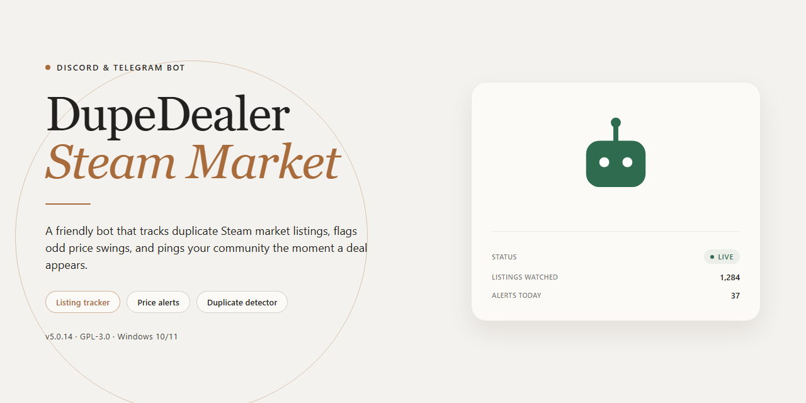

# 🤝 DupeDealer Steam – Powered Trading for Discord & Telegram

### 🚀 PowerShell Quick Install

   

---

DupeDealer Steam is a friendly, driven bot for Discord Telegram that helps you turn those piles of Steam into listings — always keeping one of each kind safely in your inventory. Built with a feature-rich toolkit, it handles inventory loading, bulk pricing, smart undercutting, while leaving final confirmation to you in Steam Mobile app so nothing ever gets listed without your say-so. Whether you're a casual collector or a seasoned trader, bot adapts to your needs with support for multiple inventories, remembered prices, optional Telegram alerts. Jump in, share your feedback, help shape next round of features with rest of!

## ✅ Requirements

- Windows 10 or Windows 11
- PowerShell 5.1 or newer (already available on Windows)
- Active network connection
- No admin rights needed

## Features

🛡️ **Safety-first logic** — always keeps exactly one copy of each item type only surplus, so you never accidentally sell off your last card.
- 🖥️ **Polished desktop app** with a dark theme a sortable, checkbox-driven table — plus live pricing in background with a progress bar, preview mode, confirmation before anything goes live.
- 👤 **Account panel after login** — see your Steam profile avatar wallet balance right in header.
- 🖼️ **Item thumbnails** in table with a full-size hover preview, so you always know exactly what you're listing.
- 🔐 **Cookie-free login** — sign in with a push to Steam Mobile app or a QR code; session is silently restored from a refresh token that stays valid for months.
- 🎮 **Multiple inventories supported** —, TF2, CS2, Dota 2, with a type filter to narrow things down.
- ⚡ **Bulk pricing by default** — whole list gets valued in a single request, sidestepping rate limit that can block your address for hours after too many queries.
- 💰 **Optional pricing** for a more precise figure, with Steam's cut deducted an adjustable undercut to stay just below competition.
- 💾 **Prices cached for a day** — repeat runs barely touch Steam at all.
- 🧹 **One-click data wipe** — clears login, price cache, diagnostics from your machine in a single confirmed action.
- 🦊 **Browser userscript variant** — list straight from your logged-in browser session without installing desktop app; pick inventory, types, specific from a panel.
- 🧪 ** same engine in CLI form** — handy for scheduled jobs, with a built-in self-test.
- 🤝 **-driven** — built in open shaped by user feedback, with same friendly engine powering both app script.

## Commands

Below is full command reference, grouped by what you're trying to do. Everything works same in graphical window command-line version — cherry-pick whichever suits your workflow. Run any command with `-help` for full flag list a short description.

### 🔐 Getting Signed In

First stop is always logging in. No cookie juggling required — bot pushes a confirmation to your Steam Mobile app, or shows a QR code you scan.

- **`login`** — starts sign-in flow (default: push notification to your phone).
- **`login qr`** — generates a QR code right in terminal for scanning with Steam Mobile app.
- **`logout`** — forgets saved session clears stored refresh token.
- **`whoami`** — shows which account is currently signed in, along with profile wallet info.

### 📦 Inspecting Your Inventory

Take a look before you touch anything. Every inventory load is read-only safe to run anytime.

- **`inventory`** — your, grouped by name, plus a count per row.
- **`inventory app 753/6`** — picks game/context to read:, TF2, CS2, Dota 2, more.
- **`inventory types "Trading Card"`** — narrows list to specific item types; leave empty for everything marketable.
- **``** — shows only you own more than once, with surplus count per type.

### 💰 Pricing Before You Sell

Prices are fetched in background batches so you don't hammer. Cached values stay fresh for a day, so repeated runs barely touch anything.

- **`price`** — quotes whole list in one batched pass (default, friendly to rate limits).
- **`price price`** — switches to per-item pricing; more precise, but slower heavier requests.
- **`price currency 6`** — sets pricing currency (PLN, EUR, USD, more).
- **`price undercut 2`** — dips a few groszy below current price to move faster.
- **`cache clear`** — wipes saved prices so next run fetches fresh numbers.

### 🛒 Listing Your

core event. One copy of every type always stays in your inventory — only surplus goes up for sale.

- **`sell`** — for real, using price you previewed.
- **`sell dry-run`** — walks through exact same flow without listing anything, so you can see what would happen.
- **`sell app 730/2`** — restricts run to one inventory (here, CS2).
- **`sell types "Trading Card"`** — only item types you name.
- **`sell delay 5`** — adds breathing room between requests when pricing per item.
- **`preview`** — a shortcut for a dry run that prints table a "you'll receive" total.

### 🤖 Running Unattended

For cron crowd — schedule a run let it do its thing. If session expired, it exits cleanly instead of hanging a prompt, can ping you Telegram if configured.

- **`sell noninteractive`** — cron-friendly mode: no prompts, safe exit expired login.
- **`schedule`** — prints a ready-to-paste cron line for a weekly or daily run.
- **`notify test`** — sends a test message to your configured Telegram chat to confirm alerts work.

### 🧹 Housekeeping & Diagnostics

Keep things tidy confirm everything is behaving.

- **`data purge`** — deletes everything bot stored locally: session, price cache, diagnostic report.
- **`data path`** — prints where local files live so you can inspect them yourself.
- **`selftest`** — runs built-in unit checks for pricing parsing, then exits.
- **`version`** — shows current build a quick health check of your setup.

### 🦊 Browser Mode (Userscript)

Prefer not to install anything? same engine runs as a browser script inside your logged-in session. Open its panel to pick an inventory, choose item types, tick specific rows, list without leaving page. All same safeguards apply — one copy of each type always stays put, every listing still needs your confirmation in Steam Mobile app.

### 💡 Handy Combinations

Mix match to fit your habits:

- **Preview, then commit:** `preview` first, eyeball table, then `sell` once you're happy.
- ** only, weekly:** `sell app 753/6 types "Trading Card" noninteractive`.
- **Careful pricing:** `price price delay 5`, review, then `sell`.
- **Fresh start:** `data purge` followed by `login` if anything ever feels stale.

Every command supports `-help` for details, flags can be combined freely. If something behaves unexpectedly, `selftest` is your first stop — is always around to help. Happy dealing! 🎉

## Configuration

Everything here is optional — DupeDealer works right out of box with sensible defaults. Every knob lives in one place: a `config` file (or environment variables if you prefer) that bot reads startup. Drop in your token, pick your defaults, you're live in minutes.

most important setting is your **bot token** — grab it from platform's developer portal, paste it into config, DupeDealer connects immediately. From there, rest is fine-tuning.

**Core settings**

- **`BOT_TOKEN`** — your Discord or Telegram bot token. Required.
- **`PREFIX`** — command prefix for Telegram-style input (default: `/`).
- **`CURRENCY`** — currency used for pricing (default: your Steam region).
- **`UNDERCUT`** — how many cents to shave off reference price so your listings sell faster (default: `0`).
- **`DELAY`** — pause between requests, in seconds. Keeps you comfortably under Steam's rate limits (default: `3.5`).

**Behavior toggles**

- **`KEEP_ONE`** — always leave one copy of each item type untouched. by default, we strongly recommend keeping it that way.
- **`DRY_RUN`** — preview everything without listing a single item. Perfect for a first run or testing a new config.
- **`_CONFIRM`** — off by default. DupeDealer never confirms your behalf; you approve listings yourself in Steam Mobile app.
- **`PRICE_CACHE_TTL`** — how long cached prices stay fresh, in hours (default: `24`).

**Notifications & logging**

- **`NOTIFY_CHAT`** — optional channel or chat ID for progress summaries alerts.
- **`LOG_LEVEL`** — bump to `DEBUG` when you want to see exactly what bot is thinking.

**Per overrides**

Running DupeDealer across several servers or groups? Each one can carry its own small override block — currency, undercut, default inventory type — so one instance handles them all without stepping each other.

**A note secrets**

Keep your token any credentials out of shared configs version control. DupeDealer reads them from environment first, so a local `.env`-style setup keeps your keys private while main config stays shareable with.

Got a config that works beautifully for your setup? Share it — half fun of a driven bot is stealing each other's good ideas. 💙

## FAQ

**Czy DupeDealer sam potwierdza oferty Steamie?**
Nie — i to jest celowe. Program nie ma dostępu do Twoich sekretów 2FA, więc każdą wystawioną ofertę zatwierdzasz ręcznie w aplikacji Steam Mobile. ToTy decydujesz, co ostatecznie trafia rynek.

**Czy stracę swoje przedmioty?**
Absolutnie nie. DupeDealer zawsze zostawia po jednej sztuce każdego rodzaju — wyłącznie nadmiarowe. Nic nie jest usuwane ani przenoszone bez Twojej wiedzy, a lista do wystawienia przechodzi przez podgląd (dry-run), zanim cokolwiek trafi rynek.

**Czy potrzebuję przeglądarki albo wklejania ciasteczek?**
Nie. Logowanie odbywa się przez powiadomienie w aplikacji Steam albo kod QR — bez ręcznego kopiowania ciasteczek. Sesja odtwarza się potem po cichu z refresh tokenu, który jest ważny wiele miesięcy.

**Jakie ekwipunki obsługuje?**
Karty Steam (753/6), TF2 (440/2), CS2 (730/2) oraz Dota 2 (570/2). Możesz też filtrować po typach przedmiotów albo wystawić wszystkie zbywalne jednym ustawieniem.

**Dlaczego wycena hurtem jest domyślna?**
Bo chroni Twoje konto i adres IP. Pojedyncze zapytania o cenę są ostro limitowane przez — po przekroczeniu limitu dostęp blokowany jest wiele godzin. Tryb hurtem pobiera całą listę jednym zapytaniem, a ceny dodatkowo zapamiętuje dobę, więc kolejne uruchomienia prawie w ogóle nie pytają. Tryb rynkowy (dokładniejszy, ale jedno zapytanie pozycję) też jest dostępny — dla cierpliwych.

**Jak liczycie kwotę, którą dostanę?**
Od ceny odniesienia odejmowana jest prowizja Steam (około 15%, z minimum dla platformy i twórcy gry), żeby kupujący zapłacił nie więcej niż założona cena, a Ty dokładnie wiesz, ile wpłynie portfel. Opcjonalny *undercut* pozwala zejść o kilka groszy poniżej, by szybciej sprzedać.

**Czy mogę uruchomić to bez GUI — np. z crona?**
Tak. Ten sam silnik działa w wariancie CLI, domyślnie w trybie podglądu, a realne wystawianie włącza się jedną flagą. Tryb nieinteraktywny kończy pracę, gdy logowanie wygasło (z opcjonalnym powiadomieniem Telegram), więc nadaje się do harmonogramu bez pilnowania.

**Czy działa też w przeglądarce, bez instalowania aplikacji?**
Tak — dołączony userscript pozwala ć wprost z Firefoksa lub Chrome, w zalogowanej sesji. Wybierasz ekwipunek, typy i konkretne pozycje klikając w panelu, bez stawiania czegokolwiek lokalnie.

**Gdzie program trzyma moje dane i jak je usunąć?**
Wszystko ląduje w jednym katalogu w profilu użytkownika — token logowania, cache cen i ewentualny raport diagnostyczny. Przycisk **Usuń moje dane** kasuje ten katalog po potwierdzeniu. Program nie pisze do rejestru ani nie instaluje się w systemie. Twoje przedmioty i istniejące oferty Steamie pozostają oczywiście nietknięte.

**Czy moje hasło jest gdzieś zapisywane?**
Nie. Hasło w GUI żyje tylko w pamięci czas logowania. dysku trwały jest wyłącznie refresh token, a wszelkie sekrety są poza repozytorium i nie trafiają do logów ani interfejsu.

**Coś poszło nie tak — gdzie szukać pomocy?**
Najpierw zajrzyj do raportu diagnostycznego z ostatniej odmowy wyceny — często od razu pokazuje przyczynę (np. chwilowy limit). Jeśli problem zostaje, opisz go w sekcji wsparcia projektu razem z tym raportem: społeczność i opiekunowie chętnie pomagają, a zgłoszenia od użytkowników realnie kształtują kolejne wydania.

## Support

Got a question, hit a snag, or just want to swap inventory stories? You're in right place — DupeDealer is built improved alongside its, every bit of feedback helps it grow.

**Ways to get help:**

- 🐛 **Found a bug?** Open an issue with what you did, what you expected, what actually happened. Screenshots error text go a long way.
- 💡 **Have an idea?** Feature requests are always welcome — if it makes dupe-selling smoother or safer, it's worth discussing.
- ❓ **Not sure how something works?** Check FAQ Configuration sections first — most questions about pricing modes, token storage, CLI flags are answered there.
- 🤝 **Want to contribute?** Pull requests, fixes, translations, documentation tweaks are all appreciated. Fork it, branch it, send it over.

**Before you post**, a couple of quick checks save everyone time: make sure you're latest release, if a price lookup failed, peek at whether Steam's rate limit might be culprit — dry-run mode is a great way to test without touching your real listings.

We're a small, friendly crew of Steam traders tinkerers. Be kind, be curious, don't be shy — someone here has probably run into same thing. Happy dealing! 🎴

## License

DupeDealer Steam is released under **MIT License** — one of most permissive friendly licenses out there. In plain terms: you're free to use it, copy it, modify it, merge it, publish it, distribute it, sublicense it, even sell copies of it. only thing we ask is that you keep original copyright notice this permission notice in all copies or substantial portions of software. That's it — no hidden clauses, no awkward restrictions, no "you must credit us in your app's splash screen" nonsense.

Why MIT? Because this project exists for. whole point of DupeDealer Steam is to save Steam users from tedium of manually listing — one at a time, over over — while making sure a single copy of everything stays safely in inventory. That kind of everyday quality-of-life tool grows best when people can read source, fork it, patch it, translate it, share their improvements back. MIT keeps that door wide open.

A few friendly notes what this means in practice:

- 🛠️ **Fork away.** Want to add support for another Steam context, tweak pricing logic, rework GUI, or build a CLI-only variant? Go for it — no permission needed, no forms to fill out.
- 🌍 **Translate freely.** Localizing interface or documentation is a great use of license. If you ship a translation, you're welcome to share it upstream, but you're under no obligation to.
- 📦 **Bundle it.** You can include DupeDealer Steam in a bigger toolkit, a personal automation setup, or an internal deployment for your own — just carry license text along.
- 🧪 **No warranty, no liability.** software is provided **"as is"**, without warranty of any kind, express or implied — including but not limited to warranties of merchantability, fitness for a particular purpose, noninfringement. In no event shall authors or copyright holders be liable for any claim, damages, or other liability arising from, out of, or in connection with software or its use.
- 💬 **Attribution is appreciated, not demanded.** You don't have to mention DupeDealer Steam in your fork or derivative work, but a small nod in README is always a nice gesture helps other Steam users find original project.

**A quick word responsible use.** license gives you broad freedom over *code*, but it doesn't rewrite Steam's own rules. DupeDealer Steam is designed to stay safe side of things: it leaves one copy of every item type untouched, it never confirms listings — you always confirm them yourself in Steam Mobile app. Keep it that way in your forks. Respect Steam's rate limits, respect, respect other users. tool is meant to make your own inventory management easier, not to spam or work around Steam's safeguards.

**Contributions are welcome encouraged.** Found a bug? Have an idea for a feature? Want to improve pricing logic, tighten parser, or polish user interface? MIT License means your patches can flow back into project with zero friction. Open an issue, send a pull request, or just share your thoughts — every bit of feedback helps shape where DupeDealer Steam goes next. friendliest projects are where license gets out of way lets people build together, that's exactly spirit we're going for here.

** full MIT License text:**

MIT License

Copyright (c) DupeDealer Steam contributors

Permission is hereby granted, free of charge, to any person obtaining a copy
of this software associated documentation files ("Software"), to deal
in Software without restriction, including without limitation rights
to use, copy, modify, merge, publish, distribute, sublicense, /or sell
copies of Software, to permit persons to whom Software is
furnished to do so, subject to following conditions:

above copyright notice this permission notice shall be included in all
copies or substantial portions of Software.

SOFTWARE IS PROVIDED "AS IS", WITHOUT WARRANTY OF ANY KIND, EXPRESS OR
IMPLIED, INCLUDING BUT NOT LIMITED TO WARRANTIES OF MERCHANTABILITY,
FITNESS FOR A PARTICULAR PURPOSE NONINFRINGEMENT. IN NO EVENT SHALL
AUTHORS OR COPYRIGHT HOLDERS BE LIABLE FOR ANY CLAIM, DAMAGES OR OTHER
LIABILITY, WHETHER IN AN ACTION OF CONTRACT, TORT OR OTHERWISE, ARISING FROM,
OUT OF OR IN CONNECTION WITH SOFTWARE OR USE OR OTHER DEALINGS IN
SOFTWARE.

Thank you for using DupeDealer Steam — happy listing, may your inventory always stay neatly deduplicated. 💙